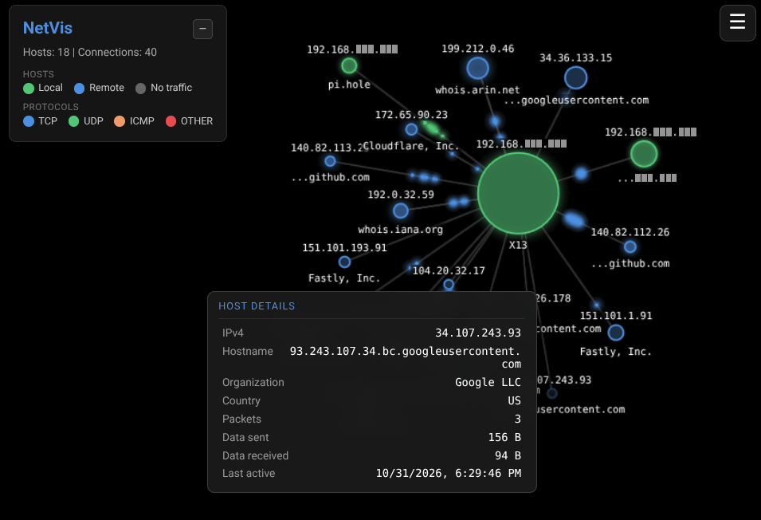

# NetVis — Network Traffic Visualizer

A live, graphical representation of network traffic. NetVis captures packets from a
network interface with libpcap, aggregates them into a host/connection graph, and
streams updates to a browser-based 2D canvas over WebSockets.



## Inspiration

This tool was inspired by [OIP](https://github.com/USU-Security/oip), a network visualization tool, as mentioned by **Neil Wyler** (a.k.a **Grifter**) in one of his talks, is used at the [Black Hat conference](https://blackhat.com/index.html) NOC. The original tool was written in C++ and had to be built from source. The setup and use was difficult, and in my testing, it wasn't very reliable. 

I wanted to try making a similar tool with more modern, and user friendly setup and interface. Thus was born NetVis.

## Requirements

- Go 1.23 or newer
- Linux with `libpcap` development headers (cgo is used)
- Root privileges or `CAP_NET_RAW`/`CAP_NET_ADMIN` for live capture

Install libpcap headers on Debian/Ubuntu:

```bash
sudo apt install libpcap-dev
```

On Fedora/RHEL:

```bash
sudo dnf install libpcap-devel
```

On Arch:

```bash
sudo pacman -S libpcap
```

## Build

```bash
go build -o netvis ./cmd/netvis
```

The resulting `netvis` binary is placed in the current directory (it is already
listed in `.gitignore`).

## Test

```bash
go test ./...
go test -race ./...
```

Tests cover packet parsing, graph aggregation and snapshot isolation, display-name
resolution caching, whois response parsing, and WebSocket hub message routing,
including traffic aggregation and frontend-traffic separation. Network-dependent
lookups are stubbed in tests.

## Run

```bash
sudo ./netvis -iface <interface> [-filter "<BPF filter>"] [-addr ":3993"]
```

Example:

```bash
sudo ./netvis -iface wlan0
sudo ./netvis -iface eth0 -filter "tcp port 443" -addr ":9090"
```

Open <http://localhost:3993> (or the address given with `-addr`) in a browser.

Run the binary from the repository root (or wherever `web/static/` is available),
because the server serves the frontend from `web/static/` relative to the current
working directory.

### Flags

| Flag | Required | Description |
| --- | --- | --- |
| `-iface` | yes | Network interface to capture on (e.g. `eth0`, `wlan0`, `any`). |
| `-filter` | no | BPF capture filter, e.g. `tcp port 80`, `udp`, `host 192.168.1.10`. |
| `-addr` | no | HTTP listen address, defaults to `:3993`. |

### Finding an interface

```bash
ip link show          # Linux
```

You can also run with `-iface any` on Linux to capture across all interfaces.

### Running without root

Instead of `sudo`, you can grant the binary capture capabilities:

```bash
sudo setcap cap_net_raw,cap_net_admin=eip ./netvis
./netvis -iface eth0
```

Note that re-building the binary replaces it and drops the capabilities, so
re-apply `setcap` after each build.

## Using the UI

### Canvas

- **Colour of host blobs**
  - Green: local/private network host
  - Blue: remote/external host
  - Grey: host that has not sent any packets (silent)
  - Dimmed: passive host, no traffic sent or received recently
  - Glowing: host that sent a packet within the recent activity window
- **Blob size** scales with traffic volume: the busiest host is the largest and
  the least busy the smallest.
- **Edges** connect IP pairs; particles travel source → destination. Only TCP
  connections to the NetVis frontend (HTTP/WebSocket) on the web port are drawn
  as a thin glowing yellow line and never animate packets.
- **Dragging** a blob repositions it; connected hosts pull toward each other via a
  force layout. Velocity is damped with drag so blobs settle instead of creeping.
  Soft repulsion accounts for label sizes (and scales with label content) with
  extra vertical spacing to keep IP addresses and hostnames separated. Long IPv6
  addresses are truncated on screen but copied in full.
- **Clicking** a host (blob or label) copies its IP address to the clipboard and
  shows a short confirmation toast.
- **Zooming** — use the `+`/`−` buttons in the bottom-right corner, the mouse wheel
  (zooms toward the cursor), or pinch on a touch device. The frame button fits all
  hosts and labels into view. One finger still drags hosts on touch devices.

### Legend

The top-left panel shows host and protocol colour legends. Use the `−`/`+`
button in its header to collapse the legend, leaving only the NetVis title and
the Hosts/Connections counters visible.

### Settings menu

Use the hamburger button in the top-right corner to open the settings panel.

| Setting | Default | Description |
| --- | --- | --- |
| Attraction local↔local | 0.100 | Force between two local hosts. |
| Attraction local↔external | 0.660 | Force between a local and an external host. |
| Attraction external↔external | 0.020 | Force between two external hosts. |
| Packet speed | 0.005 | How fast particles travel along edges. |
| Packet size | 0.3 | Scale factor for particle size. |
| Min host size | 5 | Smallest blob radius. |
| Max host size | 44 | Largest blob radius. |
| Active glow duration | 10 s | How long a host glows after sending a packet (smooth fade in/out). |
| Passive after | 120 s | Inactivity period before a host is dimmed as passive. |
| Auto-remove passive hosts | off | Continuously removes hosts once they become passive. |

Buttons:

- **Remove silent hosts** — removes hosts that have never sent a packet.
- **Remove passive hosts** — removes hosts with no traffic within the passive
  timeout.

## Project layout

```
cmd/netvis/          CLI entry point and flag parsing
internal/capture/    libpcap packet capture and parsing (gopacket)
internal/graph/      Host/edge state, reverse-DNS cache, snapshots
internal/server/     HTTP server, WebSocket hub and clients
web/static/          Frontend (HTML, CSS, canvas/JS)
DESIGN.md            Design document and implementation notes
```

## How it works

1. `capture` opens the interface with libpcap, applies an optional BPF filter and
   emits normalized events: `{ts, srcIP, dstIP, proto, bytes}`.
2. `graph` records hosts and edges keyed by `srcIP->dstIP`, accumulating packet
   counts and byte totals. Host details are resolved asynchronously: reverse DNS
   (with a 3 s timeout) for hostnames, and a whois organization/country lookup
   (via IANA referral to the responsible RIR) for external addresses. Addresses
   that resolve to the same hostname share one host identity, so a dual-stack
   host appears as a single blob. Resolved details are streamed to clients as
   `host` messages and fill in the label and host info window when they arrive.
3. `server` aggregates events per directed edge, protocol, and frontend flag
   over a fixed 16 ms window, broadcasts compact `traffic` records (with host
   messages batched alongside them), and sends a full snapshot when a client
   connects.
4. The frontend renders the snapshot, then applies queued traffic records once
   per animation frame, animating a bounded set of sampled particles and running
   a simple force layout on the canvas.

## Troubleshooting

**`pcap.h: No such file or directory`** — install the libpcap development package
listed above (the runtime library alone is not enough).

**`pcap.OpenLive: ... permission denied`** — run with `sudo` or grant
`cap_net_raw,cap_net_admin` as shown above.

**No packets appear** — check the interface name, make sure traffic matches the
BPF filter, and confirm the browser is connected (browser dev-tools WebSocket).
Loopback traffic may need `-iface lo`.

**Reverse DNS / whois is slow or empty** — lookups run asynchronously with a 3 s
reverse-DNS timeout; when no answer is available the label stays empty. Whois
requires outbound TCP port 43. IPv4/IPv6 addresses are only merged into one host
when both reverse-resolve to the same hostname, so a missing PTR record keeps
them as separate blobs.

## License

The default license is Apache 2.0 (see [LICENSE](LICENSE)). I want to be reasonable, 
so if the license is holding you back. Get in touch and let me know what you need.
I'm sure we can work something out.
